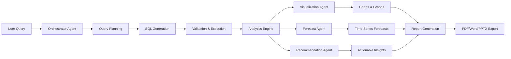
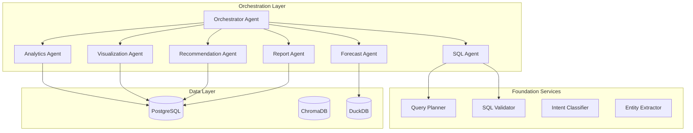
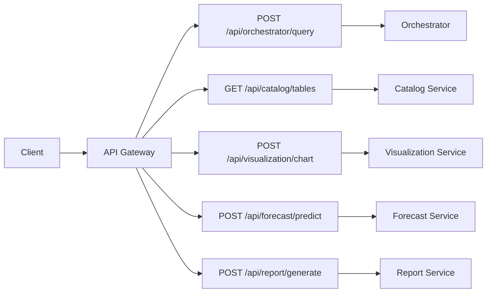

# 🤖 Enterprise Multi-Agent Business Intelligence Platform

<div align="center">


**Google Antigravity** | Production-Grade Multi-Agent BI Workspace

[](https://enterprise-bi.example.com)
[](https://github.com/samalarakshithbabu/enterprise-multi-agent-bi/issues)

</div>

---

## 🚀 Executive Summary

**Enterprise Multi-Agent Business Intelligence (BI) Platform** is a production-grade AI workspace that transforms natural language queries into actionable business intelligence. Built on a sophisticated multi-agent architecture using LangGraph, this platform enables business users to ask questions in plain English and receive comprehensive insights including SQL queries, visualizations, forecasts, and downloadable reports.

### What It Does



---

## 🎯 Problem Statement

Traditional Business Intelligence tools require:

| Challenge | Impact |
|-----------|--------|
| **Technical Expertise** | SQL knowledge required for data exploration |
| **Siloed Tools** | Separate tools for querying, visualization, and forecasting |
| **Time-Consuming** | Multiple steps to go from question to insight |
| **Limited Analytics** | Basic aggregations without AI-powered forecasting |
| **Manual Reporting** | No automated report generation |

**Our Solution:** A single platform where users ask questions naturally and receive complete BI deliverables.

---

## ✨ Key Features

### Core Capabilities

| Feature | Description |
|---------|-------------|
| **Natural Language to SQL** | Ask questions in plain English, get accurate SQL queries |
| **Multi-Agent Orchestration** | 14 specialized AI agents coordinated via LangGraph |
| **Semantic Data Catalog** | Intelligent metadata discovery and management |
| **Real-Time Visualization** | Dynamic charts powered by Recharts and Plotly |
| **Time-Series Forecasting** | ARIMA and ML-based predictive analytics |
| **Automated Reporting** | Generate PDF, Word, and PowerPoint reports |

### Agent Ecosystem



---

## 🛠️ Technology Stack

### Backend Infrastructure

| Technology | Purpose | Version |
|------------|---------|---------|
| **FastAPI** | Web framework | 0.109+ |
| **Python** | Core language | 3.12+ |
| **SQLAlchemy Async** | ORM with async support | 2.0+ |
| **PostgreSQL** | Primary database | 15+ |
| **SQLite** | Lightweight database | - |
| **DuckDB** | Analytics queries | - |
| **ChromaDB** | Vector database | - |
| **Redis** | Caching layer | - |
| **Celery** | Async task queue | - |

### AI & Machine Learning

| Technology | Purpose | Version |
|------------|---------|---------|
| **LangGraph** | Multi-agent orchestration | Latest |
| **LangChain** | LLM integration | Latest |
| **ARIMA** | Time-series forecasting | - |
| **Random Forest** | ML forecasting | scikit-learn |
| **RAG** | Knowledge base retrieval | - |

### Frontend Stack

| Technology | Purpose | Version |
|------------|---------|---------|
| **React** | UI framework | 19 |
| **Next.js** | React framework | Latest |
| **TypeScript** | Type safety | 5.3+ |
| **Tailwind CSS** | Styling | 3.4+ |
| **Zustand** | State management | Latest |
| **Recharts** | Charting library | Latest |
| **Plotly** | Advanced visualizations | Latest |

---

## 🏗️ System Architecture


---

## 📁 Project Structure

```
enterprise-multi-agent-bi/
├── 📱 frontend/                  # React 19 frontend application
│   ├── src/
│   │   ├── components/          # Reusable UI components
│   │   │   ├── Sidebar.tsx      # Navigation sidebar
│   │   │   ├── chat/            # Chat interface
│   │   │   ├── dashboard/       # Dashboard widgets
│   │   │   ├── ui/              # Base UI components
│   │   │   └── visualizer/      # Data visualizers
│   │   ├── pages/               # Route pages
│   │   │   ├── Analytics.tsx    # Analytics dashboard
│   │   │   ├── Chat.tsx         # Natural language interface
│   │   │   ├── Forecasts.tsx    # Time-series forecasts
│   │   │   ├── Reports.tsx      # Report generation
│   │   │   └── Visualizations.tsx
│   │   └── hooks/               # Custom React hooks
│   └── package.json
│
├── ⚙️ backend/                   # FastAPI backend
│   ├── app/
│   │   ├── agents/              # AI agents
│   │   │   ├── orchestrator.py  # Main orchestrator
│   │   │   ├── state.py         # Agent state management
│   │   │   └── sql_agent.py     # SQL generation agent
│   │   ├── api/                 # REST endpoints
│   │   │   ├── auth/            # Authentication
│   │   │   ├── orchestrator/    # Orchestration API
│   │   │   ├── query/           # Query execution
│   │   │   ├── visualization/   # Charts & graphs
│   │   │   ├── forecast/        # Predictions
│   │   │   └── report/          # Report generation
│   │   ├── services/            # Business logic
│   │   │   ├── analytics_service.py
│   │   │   ├── catalog_service.py
│   │   │   ├── forecast_service.py
│   │   │   ├── orchestrator_service.py
│   │   │   ├── sql_agent_service.py
│   │   │   ├── visualization_service.py
│   │   │   └── rag_service.py
│   │   ├── core/                # Core utilities
│   │   │   ├── config.py        # Configuration
│   │   │   ├── security.py      # Security utilities
│   │   │   └── sandbox.py       # Query sandbox
│   │   ├── db/                  # Database layer
│   │   │   ├── session.py       # DB sessions
│   │   │   ├── chroma_client.py # ChromaDB adapter
│   │   │   └── duckdb_client.py # DuckDB adapter
│   │   └── models/              # Data models
│   └── requirements.txt
│
├── 📊 mlflow/                    # ML model tracking
├── 📈 grafana/                   # Monitoring dashboards
├── 🚀 prometheus/                # Metrics collection
├── 🐳 docker-compose.yml         # Docker orchestration
├── 📋 deployment_guide.md        # Deployment instructions
└── 📖 README.md                  # This file
```

---

## 📋 Module Status

| Module | Status | Description |
|--------|--------|-------------|
| Authentication | ✅ Complete | Secure JWT-based authentication |
| Database Connection Manager | ✅ Complete | Multi-database support |
| Semantic Data Catalog | ✅ Complete | Intelligent metadata discovery |
| Query Planning Engine | ✅ Complete | Intent classification & planning |
| SQL Generation & Optimizer | ✅ Complete | Secure query generation |
| SQL Validation & Execution | ✅ Complete | Safe query execution |
| Enterprise Analytics Agent | ✅ Complete | Metrics aggregation |
| Enterprise Visualization Agent | ✅ Complete | Dynamic chart generation |
| Enterprise Forecast Agent | ✅ Complete | Time-series predictions |
| Enterprise Recommendation Agent | ✅ Complete | AI-powered insights |
| Enterprise Report Agent | ✅ Complete | PDF/Word/PPTX export |
| LangGraph Multi-Agent Orchestrator | ✅ Complete | Agent coordination |
| Enterprise RAG Knowledge Base | ✅ Complete | Semantic search |
| React 19 Frontend | ✅ Complete | Full UI implementation |

---

## 🛠️ Installation

### Prerequisites

- Python 3.12 or higher
- Node.js 18+ and npm
- PostgreSQL 15+ (or use SQLite)
- Redis (optional, for caching)
- Git

### 1. Clone Repository

```bash
git clone https://github.com/samalarakshithbabu/enterprise-multi-agent-bi.git
cd enterprise-multi-agent-bi
```

### 2. Backend Setup

```bash
# Create virtual environment
python -m venv .venv

# Activate virtual environment
# Windows:
.venv\Scripts\activate

# Linux/Mac:
source .venv/bin/activate

# Install Python dependencies
cd backend
pip install -r requirements.txt

# Configure environment
cp .env.example .env
# Edit .env with your database credentials
```

### 3. Frontend Setup

```bash
# Return to root and setup frontend
cd ../frontend

# Install npm dependencies
npm install

# Create environment file
cp .env.example .env.local
```

### 4. Database Setup

```bash
# Create PostgreSQL database
createdb enterprise_bi

# Or use SQLite for development (default)
# No additional setup required
```

---

## 🚀 Running the Application

### Development Mode

#### Start Backend
```bash
cd backend
uvicorn app.main:app --host 127.0.0.1 --port 8000 --reload
```
- API available at: `http://localhost:8000`
- API Documentation: `http://localhost:8000/docs`

#### Start Frontend
```bash
cd frontend
npm run dev
```
- Frontend available at: `http://localhost:3000`

### Production Mode

```bash
# Build frontend
cd frontend
npm run build

# Start with Docker
docker-compose -f docker-compose.prod.yml up -d
```

### Running Tests

```bash
# Backend tests
cd backend
pytest

# Frontend tests
cd frontend
npm run test
```

---

## 📖 Usage Guide

### 1. Natural Language Query Interface

The main interface allows users to ask business questions in plain English:

```
User: "Show me total sales by region for Q4 2024"

System:
├── Intent: Sales Analysis
├── SQL Generated: SELECT region, SUM(sales) FROM ... GROUP BY region
├── Results: [Chart showing sales by region]
├── Forecast: Q1 2025 prediction included
└── Report: PDF ready for export
```

### 2. Dashboard Views

| Page | Description |
|------|-------------|
| **Chat** | Natural language query interface |
| **Analytics** | Aggregated metrics and KPIs |
| **Visualizations** | Interactive charts and graphs |
| **Forecasts** | Time-series predictions |
| **Reports** | Exportable reports (PDF/Word/PPTX) |
| **Settings** | System configuration |

### 3. API Endpoints



---

## 🔐 Security Features

- **JWT Authentication** - Secure token-based access
- **SQL Injection Protection** - Parameterized queries and validation
- **Query Sandboxing** - Safe execution environment
- **Role-Based Access** - Granular permission control
- **Audit Logging** - Complete activity tracking

---

## 📦 Export Formats

| Format | Use Case |
|--------|----------|
| **PDF** | Printable reports, presentations |
| **Word** | Document editing, documentation |
| **PowerPoint** | Executive presentations |
| **Excel** | Data export, further analysis |

---

## 🔮 Future Improvements

- [ ] Additional LLM providers (Claude, Groq)
- [ ] Real-time data streaming
- [ ] Mobile application
- [ ] Multi-tenant support
- [ ] Custom agent creation
- [ ] Advanced NLP for complex queries

---

## 📄 License

This project is licensed under the MIT License.

---

## 👨‍💻 Author

**SAMALA RAKSHITH BABU**

- 📧 Email: samalarakshithbabu7@gmail.com
- 💼 LinkedIn: [samala-rakshith-babu](https://www.linkedin.com/in/samala-rakshith-babu/)
- 🐙 GitHub: [samalarakshithbabu](https://github.com/samalarakshithbabu)

---

<div align="center">

**Built with ❤️ for Enterprise Business Intelligence**

</div>